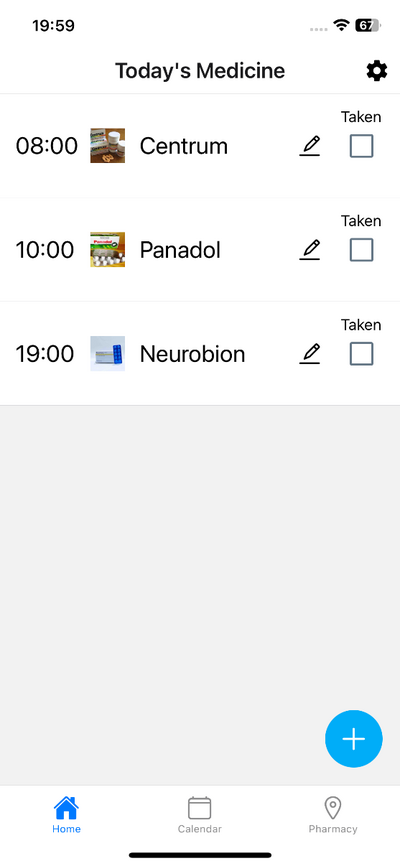
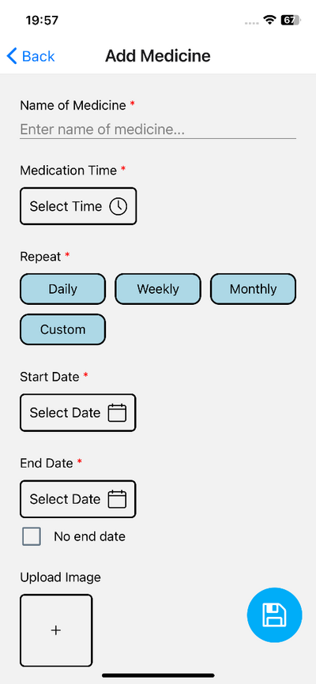
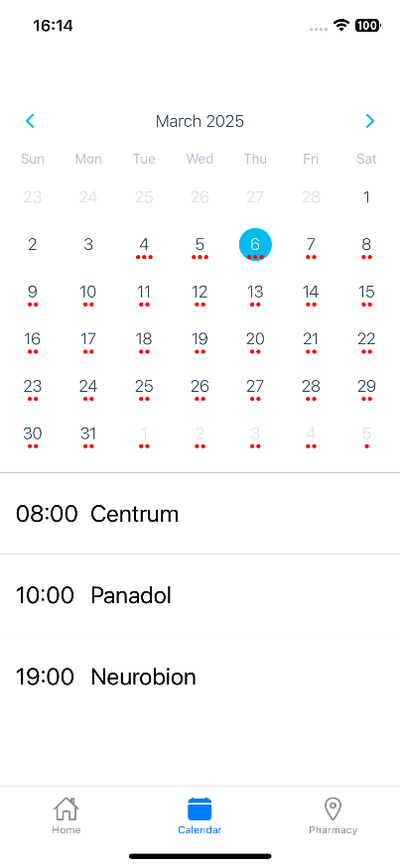
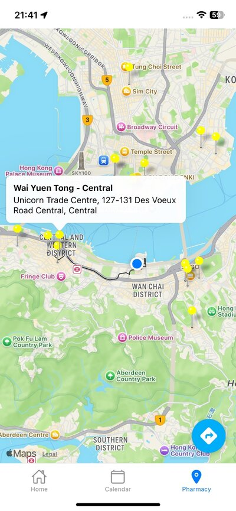

# PillPal

Never miss your medicine again: a cross-platform mobile app that reminds you when
to take each medication and shows you where the nearest pharmacy is.

Built with React Native and Expo (SDK 51) with a Firebase backend, as my final
project for CM3050 Mobile Development.

<p align="center">
  
  
  
  
</p>
<p align="center"><em>Today's doses · adding a medicine · calendar schedule · pharmacy finder</em></p>

> **▶ Try it:** run it locally with Expo Go (see [Getting started](#getting-started)).
> API keys and Firebase config are read from environment variables (see
> `.env.example`), so you'll need your own Firebase project and Google Maps key.

## Motivation

People around me, aging relatives and friends with chronic illnesses, kept
running into the same problem: once in a while they were unsure whether they'd
already taken the dose for that timeslot. Pill boxes fall short when you take
more than a few pills a day, and calendar apps get cluttered fast when every
dose is its own event. My original idea was a broader first-aid app, but after
showing wireframes to target users it was clear the medicine reminder was the
part they actually wanted, so I narrowed the scope to that.

## Features

- **Medication reminders:** add a medicine with start/end date, time, and repeat
  interval; the app schedules local push notifications.
- **Today's overview + "Taken" checkbox:** mark a dose as taken so the reminder
  for that slot is cancelled; resets on the next scheduled day.
- **Medicine thumbnails:** attach a photo of each medicine, stored in Firebase
  Storage.
- **Calendar view:** see the medication schedule across dates and tap a day for
  details.
- **Pharmacy finder:** map of nearby pharmacies via Google Places, with
  directions.
- **Per-user accounts:** username-based registration and login backed by
  Firebase Auth, data synced per user in Firestore.

## Usage

Register with a username and password (no personal details needed), log in, and
add each medicine with its time, dates, and repetition. The home screen shows
today's doses with a checkbox to tick off each one as you take it. The calendar
tab shows the schedule for any date (handy for packing before a trip), and the
location tab finds pharmacies near you when something runs out.

## Getting started

1. You'll need Node 20+, and an Android/iOS device with
   [Expo Go](https://expo.dev/go) (SDK 51 version) or an emulator.
2. `npm install`
3. Copy `.env.example` to `.env` and fill in your Firebase config and Google
   Maps key. In the Firebase console, enable Email/Password sign-in and apply
   `firestore.rules` to your Firestore database.
4. `npm start`, then scan the QR code with Expo Go.
5. Tests: `npm test`.

To build a standalone APK: `npx eas-cli build -p android --profile preview`
(cloud build; add the env vars as EAS environment variables since `.env` isn't
uploaded). For a local build you'll also need JDK 17 and the Android SDK
(platform 34), and note that React Native 0.74 needs Gradle 8.6. The native
`android/` folder isn't committed; `npx expo prebuild --platform android`
regenerates it.

## Project structure

```
App.js              # root component, navigation tabs and notification setup
CustomNavigation.js # auth stack, switches on login state
GlobalContext.js    # app-wide state: auth listener, medicines, notification scheduling
FirebaseConfig.js   # Firebase init (config from env vars)
app.config.js       # Expo config (Maps key from env vars)
firestore.rules     # Firestore security rules
components/         # the eight app screens (login, home, add medicine, map, etc.)
__tests__/          # Jest snapshot tests for every screen
```

`GlobalContext.js` is the heart of the app: it holds the shared state and does
the date maths for scheduling and cancelling notifications.

## Development notes

The app started life as coursework and I've since cleaned it up for release.
The biggest lesson: the first version stored usernames and passwords directly
in Firestore and compared them on login. Rolling my own auth felt simple at the
time, but storing plaintext credentials is exactly the mistake it looks like,
so I migrated to Firebase Auth. Login stays username-based (usernames map to
synthetic emails under the hood), passwords are handled entirely by Firebase,
and sessions persist across app restarts.

Every screen has a Jest snapshot test (`jest-expo`, run for both iOS and
Android) with the database, API calls, and device sensors mocked out.

**Known limitations:** notification repetition is only reliable for Weekly and
Monthly schedules. Daily reminders starting on a future date and Custom
intervals fire once instead of repeating, end dates don't automatically cancel
repeats (the app cancels them next time it's opened), and ticking "Taken"
cancels future repeats as well as today's. The proper fix is server-side
scheduling pushed to the device via Firebase Cloud Messaging, which I scoped in
the project report but didn't build.

## License

Source code is released under the [MIT License](LICENSE).
